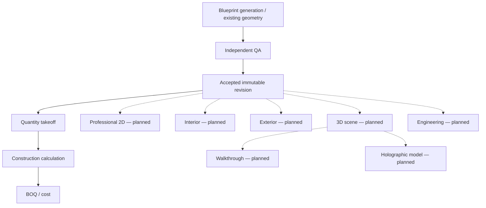

# Phase 16 — workflow architecture review report

Baseline: `1de93400a8ed768b438b2d5a35a197524c546374`, exactly `backend-v1-phase15-complete`. Prior baseline evidence records the initial clean checkout. On 2026-10-01 the resumed session found the existing uncommitted Phase 16 work, stopped as instructed, and continued only after the user's explicit authorization. The review preserved that implementation and prior evidence and added the optional-cost partial-success acceptance case. See [design](phase16-design.md), [machine-readable verification](phase16-verification.json) and [actual acceptance examples](phase16-example.json).

## 1. Implemented

Backend-only workflow orchestration over the existing project/revision/QA/takeoff/construction/cost engines: six strict modes, thirteen versioned capabilities, dependency validation, deterministic planning, explicit required/optional outputs, exact-source reuse, owner-private persistence, atomic per-step manifests, durable receipts, interruption recovery, discovery and workflow APIs. No earlier engine algorithms or formulas changed.

## 2. Mode model

| Mode | Meaning and current execution |
|---|---|
| COMPLETE_BUILDING | Generate or reuse accepted geometry, then takeoff, construction and BOQ/cost. Explicit specification, synthetic rate book and costing policy required. |
| BLUEPRINT_ONLY | Generate or reuse accepted geometry and stop at its immutable revision. Calculations occur only when requested through output extensions. |
| INTERIOR_ONLY | Existing accepted revision plus validated target space IDs and bounded design brief/style/material preferences. BLOCKED because the engine is planned. |
| EXTERIOR_ONLY | Existing accepted revision plus named facade and bounded design brief/style/material preferences. Contract only. |
| THREE_D_ONLY | Existing accepted architectural V2 revision plus scene purpose. Contract only. |
| ENGINEERING_ONLY | Existing accepted architectural V2 revision plus explicit discipline/source type/brief. Contract only; no structural analysis. |

All modes attach to an existing project. Generation specifies `source.kind = GENERATE`, structured `requirements`, and explicit nullable `baseRevisionId`; reuse specifies `source.kind = REVISION` and exact `sourceRevisionId`. The request cannot contain arbitrary artifact IDs, generated reports, owner IDs or capability availability overrides.

## 3. Capability registry

| Capability | Status | Version | Dependency |
|---|---|---|---|
| BLUEPRINT_GENERATION | AVAILABLE | precision-blueprint-v1 | Structured requirements; accepted revision can satisfy geometry reuse |
| BLUEPRINT_QA | AVAILABLE | blueprint-qa-v1 | BLUEPRINT_GENERATION / existing accepted geometry |
| REVISION_PERSISTENCE | AVAILABLE | project-revision-v1 | BLUEPRINT_QA |
| QUANTITY_TAKEOFF | AVAILABLE | quantity-takeoff-v1 | REVISION_PERSISTENCE |
| CONSTRUCTION_CALCULATION | AVAILABLE | construction-calculation-v1 | QUANTITY_TAKEOFF |
| BOQ_COST | AVAILABLE | boq-cost-v1 | CONSTRUCTION_CALCULATION |
| PROFESSIONAL_2D | PLANNED | contract-v1 | REVISION_PERSISTENCE |
| INTERIOR_DESIGN | PLANNED | contract-v1 | REVISION_PERSISTENCE |
| EXTERIOR_DESIGN | PLANNED | contract-v1 | REVISION_PERSISTENCE |
| SCENE_3D | PLANNED | contract-v1 | REVISION_PERSISTENCE |
| ENGINEERING_ANALYSIS | PLANNED | contract-v1 | REVISION_PERSISTENCE |
| WALKTHROUGH | PLANNED | contract-v1 | SCENE_3D |
| HOLOGRAPHIC_MODEL | PLANNED | contract-v1 | SCENE_3D |

Each entry also declares accepted input types and a strict produced artifact type. Dependencies pin capability versions. Metadata is deeply frozen and validated at startup and in tests. Historical accepted revision/QA versions are retained in reused manifests; supplied architecture is identified as `supplied-v2`, not falsely attributed to the generator. The available engine versions are the existing package exports. Future versions are contract identifiers, not implementations.

## 4. Workflow planner

`planWorkflow(request, validatedSourceEvidence, registry)` is pure: no database, network, time, randomness, AI or input mutation. Normalized set-valued output selections and fixed registry order yield deterministic topological plans. The plan lists required and optional dependency closures, execution/reuse/unavailable actions, dependency versions, expected artifact types, reused references and explicit unavailable reasons. Registry validation rejects duplicates, missing dependencies/versions, invalid artifact kinds and cycles. Traversal has count, depth and operation bounds.

Database source resolution is a separate stage. It validates ownership, exact revision acceptance, interior space IDs and existing artifact fingerprints before providing evidence to the planner. Plan-only requests create neither workflows nor artifacts.

## 5. Dependency graph



The artifact graph is a reference graph over the existing normalized tables. It does not replace them with a generic report store.

## 6. COMPLETE_BUILDING

Current execution: structured requirements → existing blueprint engine → independent QA → existing signed revision commit → takeoff → construction → cost. Generation, QA and revision are three conceptual plan steps implemented by the existing atomic revision operation. The remaining engines retain their individual existing signed validation and artifact fingerprint semantics.

Acceptance asserts exactly six output references with the same project/revision ancestry and linked takeoff/construction sources. The synthetic sample rate book is explicit. The demonstrated cost remains `PARTIALLY_PRICED`, with `completeTotalAvailable = false`; workflow COMPLETED does not upgrade partial quantity/material/cost coverage. Optional future capabilities remain PLANNED in the result plan.

## 7. BLUEPRINT_ONLY

Acceptance verifies exactly three references: BUILDING_MODEL, BLUEPRINT_QA and PROJECT_REVISION. Independent SQL assertions verify **zero takeoff, zero construction-calculation and zero cost rows** for that revision. API checks also verify empty downstream collections. Explicit extensions such as `requiredOutputs: ["CONSTRUCTION_CALCULATION"]`, with a construction specification, enable only the necessary dependency chain.

## 8. Future mode contracts

Interior target IDs must exist in the selected immutable model; exterior selects NORTH/SOUTH/EAST/WEST/ALL; 3D requires accepted V2 geometry; engineering declares an architectural V2 source and analysis discipline. All four return a persisted BLOCKED run whose plan reports `CAPABILITY_NOT_IMPLEMENTED`. Existing geometry references may be reused, but no future artifact is emitted. Drawings, walkthroughs and holographic models also remain registry contracts only.

## 9. Artifact reuse

The downstream acceptance case first produces a revision, takeoff and construction calculation via an extended blueprint workflow. A COMPLETE_BUILDING request explicitly selects that revision. Its planner returns only `BOQ_COST` in `executableCapabilities`; all five upstream references keep their original IDs and are marked REUSED. A fresh run after cost exists has no executable steps. Engine spies independently prove source reuse causes no new blueprint generation or QA calls. Historical project metadata and revisions remain unchanged.

Takeoff matching includes immutable model, revision, engine, measurement policy and normalized options. Construction matching also includes exact takeoff identity/report hash, recipe pack, normalized specification/options and engine. Cost matching includes exact construction identity/report hash, rate-book hash, costing-policy hash, options and engine. Lookup uses existing unique fingerprint indexes, not unbounded pagination or “latest” selection.

## 10. Workflow output manifest

The complete exact JSON result is in [phase16-example.json](phase16-example.json); its UUIDs come from a disposable PostgreSQL acceptance run. Its exact six-entry manifest is:

```json
[
  {
    "capability": "BLUEPRINT_GENERATION",
    "artifactType": "BUILDING_MODEL",
    "artifactId": "aa3c56ae-92aa-4fc5-b259-ab25f4007476",
    "projectRevisionId": "aa3c56ae-92aa-4fc5-b259-ab25f4007476",
    "status": "CREATED",
    "version": "precision-blueprint-v1",
    "coverage": null,
    "sourceArtifactIds": []
  },
  {
    "capability": "BLUEPRINT_QA",
    "artifactType": "BLUEPRINT_QA",
    "artifactId": "8a859d33-f8ff-420e-bc10-fd6b19c15c58",
    "projectRevisionId": "aa3c56ae-92aa-4fc5-b259-ab25f4007476",
    "status": "CREATED",
    "version": "blueprint-qa-v1",
    "coverage": "PASS",
    "sourceArtifactIds": [
      "aa3c56ae-92aa-4fc5-b259-ab25f4007476"
    ]
  },
  {
    "capability": "REVISION_PERSISTENCE",
    "artifactType": "PROJECT_REVISION",
    "artifactId": "aa3c56ae-92aa-4fc5-b259-ab25f4007476",
    "projectRevisionId": "aa3c56ae-92aa-4fc5-b259-ab25f4007476",
    "status": "CREATED",
    "version": "project-revision-v1",
    "coverage": null,
    "sourceArtifactIds": [
      "8a859d33-f8ff-420e-bc10-fd6b19c15c58"
    ]
  },
  {
    "capability": "QUANTITY_TAKEOFF",
    "artifactType": "QUANTITY_TAKEOFF",
    "artifactId": "983280f8-1431-45fe-b682-93ab9ffd47fc",
    "projectRevisionId": "aa3c56ae-92aa-4fc5-b259-ab25f4007476",
    "status": "CREATED",
    "version": "quantity-takeoff-v1",
    "coverage": "PARTIAL",
    "sourceArtifactIds": [
      "aa3c56ae-92aa-4fc5-b259-ab25f4007476",
      "8a859d33-f8ff-420e-bc10-fd6b19c15c58"
    ]
  },
  {
    "capability": "CONSTRUCTION_CALCULATION",
    "artifactType": "CONSTRUCTION_CALCULATION",
    "artifactId": "cd5d5360-230d-4848-a240-7c4a6c940b5c",
    "projectRevisionId": "aa3c56ae-92aa-4fc5-b259-ab25f4007476",
    "status": "CREATED",
    "version": "construction-calculation-v1",
    "coverage": "PARTIAL",
    "sourceArtifactIds": [
      "983280f8-1431-45fe-b682-93ab9ffd47fc"
    ]
  },
  {
    "capability": "BOQ_COST",
    "artifactType": "BOQ_COST",
    "artifactId": "63c45cb8-7f2c-42d3-bd3d-66a788a972f3",
    "projectRevisionId": "aa3c56ae-92aa-4fc5-b259-ab25f4007476",
    "status": "CREATED",
    "version": "boq-cost-v1",
    "coverage": "PARTIALLY_PRICED",
    "sourceArtifactIds": [
      "983280f8-1431-45fe-b682-93ab9ffd47fc",
      "cd5d5360-230d-4848-a240-7c4a6c940b5c"
    ]
  }
]
```

The six current manifest entries refer respectively to the immutable model-bearing revision, acceptance QA, revision, takeoff, construction calculation and cost estimate. Coverage remains the original artifact status. Unavailable capabilities are separate plan records with capability, implementationStatus, reason and required flag; they never receive fake artifact IDs.

## 11. Required / optional outputs

Mode defaults plus `requiredOutputs` define required dependency closure. Any unavailable required capability blocks the whole workflow before new artifacts are created. Optional unavailable capabilities remain explicit without reducing a supported workflow from COMPLETED. COMPLETE_BUILDING defaults drawings/interior/exterior/scene/engineering to optional future outputs. Explicitly requiring one makes it blocking. User-provided required and optional lists must be disjoint, bounded and composed of known capability IDs.

Known downstream domain failures preserve successful upstream outputs and produce PARTIALLY_COMPLETED or FAILED with a bounded typed error. Shared PostgreSQL/live-Supabase acceptance explicitly requests required takeoff, optional cost and optional 3D: incompatible cost currency produces `COST_POLICY_INVALID`, all required outputs remain in the manifest, no cost artifact is persisted, 3D remains `CAPABILITY_NOT_IMPLEMENTED`, and idempotent replay preserves the exact partial result. Infrastructure failures propagate as HTTP errors and leave recorded RUNNING progress for explicit recovery; they are not silently retried.

## 12. Persistence

`public.project_workflow_runs` stores immutable identity/request/plan/fingerprint, exact source revision, current manifest, bounded errors, execution status and timestamps. Internal fields hold creator, hashed idempotency key/context and a fenced execution token/expiry. A composite FK enforces source revision/project ancestry. Existing artifact tables remain authoritative.

State transitions: plan response PLANNED or BLOCKED; persisted execution starts RUNNING and ends COMPLETED, BLOCKED, PARTIALLY_COMPLETED or FAILED. Terminal rows reject updates/deletes, including accidental privileged mutation. Each existing signed artifact RPC runs inside a signed workflow wrapper transaction that also validates and appends its manifest reference. Final status and durable receipt are atomic in a separate final transaction. The entire multi-step workflow is deliberately not one all-or-nothing transaction.

## 13. API

| Method and route | Semantics |
|---|---|
| GET `/api/capabilities` | Safe public mode/capability/version/dependency metadata only. |
| POST `/api/projects/:projectId/workflows/plan` | Owner-only source validation and pure planning; HTTP 200; no persistence. |
| POST `/api/projects/:projectId/workflows` | Owner-only synchronous execution and immutable terminal result; HTTP 201 for created/replayed workflow records, including explicit blocked/partial/failed states. |
| GET `/api/projects/:projectId/workflows` | Owner-only summaries, cursor pagination, limit 1–100; excludes request/plan bodies. |
| GET `/api/projects/:projectId/workflows/:workflowRunId` | Owner-only exact workflow record and compact artifact manifest. |

Request bodies are limited to 128 KiB, at most thirteen selected outputs/steps/manifest entries and twenty errors. There is one route family. Auth, strict validation, not-found, unavailable-configuration and idempotency conflicts retain existing API error conventions. A competing active execution returns 409 WORKFLOW_IN_PROGRESS. Inspect its run and explicitly resend the identical request after execution or, for interruption recovery, lease expiry.

## 14. Security / RLS

Workflow access derives from project ownership regardless of PUBLIC project visibility. Other users receive no rows/not-found; unauthenticated API access is denied. Direct client INSERT/UPDATE/DELETE and anonymous SQL reads are denied. Signed writes bind user, operation, exact input, idempotency context and expiry. Database validation independently checks accepted revision, artifact existence, artifact metadata and exact takeoff/construction ancestry. Tokens cannot override availability, inject reports or cross project boundaries.

Live acceptance uses actual Auth sessions, JWTs, PostgREST and RLS. Service-role access is used only by the existing test setup/cleanup, never to prove owner behavior. New immutable workflow-bearing test projects follow the existing retained-artifact convention on test-user cleanup.

## 15. Idempotency

The existing `durableCommand` / `idempotency_records` mechanism is reused. Fingerprints are canonical SHA-256 over workflow version, project and normalized request, including mode, source revision/base, required/optional selections and engine inputs/options. Timestamps and produced output IDs are excluded.

Same user/key/request returns the identical run, timestamps and manifest. Changed mode/revision/project/outputs/options conflicts. Identical keys across users are isolated. Keyless identical requests converge through a deterministic internal key in the same receipt system. Explicit new keys can request a distinct workflow record while reusing the same canonical artifacts. Run identity survives the existing 24-hour receipt expiry, preserving replay and conflict semantics for retained runs.

Concurrent execution uses a five-minute renewable database lease and a fenced token, not a background job. On an infrastructure interruption, an explicit resend after expiry resumes existing recorded steps without duplicating the revision. Crash rollback and stale-token rejection are tested. There is no automatic retry or worker.

## 16. Migration

Only `0010_workflows.sql` was added. It adds the workflow table, index, RLS/read grants, terminal immutability trigger, signed write/read RPCs and private projection/manifest validation helpers; it extends the existing idempotency operation allowlist. Migrations 0001–0009 are unchanged.

Before additive local application, the stack contained 127 projects, 137 revisions and 51 cost estimates, with migrations 0001–0009 present. `npx supabase migration up --local` applied only 0010. No reset, deletion or historical data rewrite occurred. Every PostgreSQL integration suite replays the complete migration history into disposable databases.

At resumption, read-only inspection confirmed migrations 0001–0010 already installed, with 211 projects, 224 revisions, 87 cost estimates and 60 workflows. No migration reapplication or reset was needed. The live gates add their own acceptance fixtures using the existing setup/cleanup conventions.

## 17. Files changed

New production modules: `apps/api/src/contracts/workflows.ts`, `workflows/{registry,planner,sources}.ts`, `services/workflow-service.ts`, `lib/workflow-repository.ts`, `routes/workflows.ts`, and `supabase/migrations/0010_workflows.sql`.

New tests: `apps/api/tests/workflows.test.ts`, `workflows.integration.test.ts`, `test-support/workflow-acceptance.ts`, `test-support/supabase-failure-evidence.ts`. Existing test transports, live acceptance registration/cleanup, migration inventories and pgTAP permissions were extended. Root npm scripts include the dedicated suite and include workflow coverage in unit/integration gates. Documentation includes the design, this report, exact example JSON, gate results and test/HTTP evidence.

## 18. Baseline production files modified

Exactly three Phase 5–15 production files changed:

| File | Reason |
|---|---|
| `apps/api/src/app.ts` | Import and register the additive workflow routes. |
| `apps/api/src/lib/repository.ts` | Add the optional workflow RPC transport contract. |
| `apps/api/src/lib/supabase.ts` | Add caller-JWT workflow RPC transport and error mapping. |

No existing project/generation/QA/takeoff/construction/cost services, contracts or engine implementation files changed. Additional existing non-production files changed: root `package.json`, live Supabase test, PostgreSQL transport, migration inventory test, pgTAP test and the strict generator-boundary allowlist test (only the new public schema/version imports were allowed).

## 19. Tests

New dedicated coverage: **32 pure planner/registry/contract tests and 19 PostgreSQL workflow tests = 51 tests**. Ten shared workflow acceptance cases plus one direct SDK/RLS case add **11 live Supabase tests**, taking that suite from 36 to **47**. Five workflow permission assertions extend pgTAP from 39 to **44**.

Coverage includes real current generation-to-cost execution, blueprint-only row counts, partial cost coverage, exact source reuse, upstream engine call counts, future contracts, required/optional semantics, normalized fingerprints, stable pagination, no upstream mutation, changed-input conflicts, cross-user isolation, keyless/keyed concurrency, atomic artifact/manifest rollback, atomic terminal/receipt rollback, interrupted execution resume, stale fencing, signed-projection forgery and missing signing configuration.

## 20. Verification

The fresh 2026-10-01 gate completed successfully: **all 22 commands exited 0**. Integration passed three consecutive times; live Supabase passed twice consecutively. No gate tests were intentionally skipped and no failed application operation was silently retried. The exact start times, durations, counts and retained log paths are in [phase16-verification.json](phase16-verification.json); [prior verification](phase16-evidence/resume-2026-10-01/previous-verification.json) is preserved.

| Gate | Exact command | Result |
|---|---|---|
| [build](phase16-evidence/resume-2026-10-01/build.txt) | `npm run build` | PASS — exit 0 |
| [typecheck](phase16-evidence/resume-2026-10-01/typecheck.txt) | `npm run typecheck` | PASS — exit 0 |
| [lint](phase16-evidence/resume-2026-10-01/lint.txt) | `npm run lint` | PASS — exit 0 |
| [unit](phase16-evidence/resume-2026-10-01/unit.txt) | `npm run test:unit` | PASS — 1468/1468 tests |
| [generator](phase16-evidence/resume-2026-10-01/generator.txt) | `npm run test:generator` | PASS — 461/461 tests |
| [blueprint](phase16-evidence/resume-2026-10-01/blueprint.txt) | `npm run test:blueprint` | PASS — 137/137 tests |
| [blueprint-qa](phase16-evidence/resume-2026-10-01/blueprint-qa.txt) | `npm run test:blueprint-qa` | PASS — 177/177 tests |
| [projects](phase16-evidence/resume-2026-10-01/projects.txt) | `npm run test:projects` | PASS — 23/23 tests |
| [takeoff](phase16-evidence/resume-2026-10-01/takeoff.txt) | `npm run test:takeoff` | PASS — 23/23 tests |
| [construction](phase16-evidence/resume-2026-10-01/construction.txt) | `npm run test:construction` | PASS — 34/34 tests |
| [cost](phase16-evidence/resume-2026-10-01/cost.txt) | `npm run test:cost` | PASS — 39/39 tests |
| [workflows](phase16-evidence/resume-2026-10-01/workflows.txt) | `npm run test:workflows` | PASS — 51/51 tests |
| [integration-1](phase16-evidence/resume-2026-10-01/integration-1.txt) | `npm run test:integration` | PASS — 125/125 tests |
| [integration-2](phase16-evidence/resume-2026-10-01/integration-2.txt) | `npm run test:integration` | PASS — 125/125 tests |
| [integration-3](phase16-evidence/resume-2026-10-01/integration-3.txt) | `npm run test:integration` | PASS — 125/125 tests |
| [supabase-1](phase16-evidence/resume-2026-10-01/supabase-1.txt) | `npm run test:supabase` | PASS — 47/47 tests |
| [supabase-2](phase16-evidence/resume-2026-10-01/supabase-2.txt) | `npm run test:supabase` | PASS — 47/47 tests |
| [check](phase16-evidence/resume-2026-10-01/check.txt) | `npm run check` | PASS — 1595/1595 tests |
| [db-rls](phase16-evidence/resume-2026-10-01/db-rls.txt) | `npm run db:test` | PASS — 44/44 pgTAP assertions |
| [docker](phase16-evidence/resume-2026-10-01/docker.txt) | `docker build -t designflow-api:phase16 .` | PASS — exit 0 |
| [smoke](phase16-evidence/resume-2026-10-01/smoke.txt) | `node scripts/smoke-container.mjs designflow-api:phase16` | PASS — non-root; liveness 200; unavailable-dependency readiness 503; SIGTERM exit 0 |
| [diff-check](phase16-evidence/resume-2026-10-01/diff-check.txt) | `git diff --check` | PASS — exit 0 |

Disposable PostgreSQL integration replays all migrations 0001–0010. Existing 0001–0009 migration files remain unchanged. The Docker smoke runs without external network access. Final documentation and evidence updates were followed by another successful whitespace/diff check.

## 21. Supabase 500 status

The two final 2026-10-01 live runs passed **47/47 each**, consecutively, on the existing PostgREST 16.3 service. Each observed **1,380 requests**: **zero API 5xx, zero upstream 5xx, zero JWT timing errors, zero transport errors, and zero unexpected failures**. Each captured twelve intentional 401/42501 permission-denial responses. The durable-operation 500 did **not** recur; no Phase 16 infrastructure or application fix was required.

Exact retained evidence: [first live trace](phase16-evidence/supabase-2026-10-01T04-43-33.718Z.json), [second live trace](phase16-evidence/supabase-2026-10-01T04-44-11.940Z.json), and [watch summary](phase16-evidence/supabase-watch-summary.json). Earlier 46-test verification traces are retained separately as historical evidence.

Acceptance observation does not retry. It captures unexpected upstream 5xx/JWT failures with endpoint, operation method, full error body, response headers/request ID when available, JWT timing claims, API request IDs and available PostgREST logs. JWTs and credentials are redacted. The [Phase 15 investigation](supabase-500-investigation.md) records the previously reproduced September 30 PostgREST 16.2 validator-clock defect and controlled comparison with 16.3; that repair was already present at this session's start. Phase 16 establishes no new root cause and does not retrospectively attribute older incidents whose response bodies were lost.

## 22. Limitations

Execution is synchronous, with an explicit resend after interrupted-run lease expiry; there is no worker, queue or cancellation platform. Capability and mode registration is source-controlled. Current workflow contracts require an existing project, and specialized modes require an accepted architectural revision; standalone room/photo workflows and structural model ingestion are not implemented. Construction specifications and the existing synthetic rate-book/cost policies must be supplied explicitly. COMPLETED denotes completion of supported requested execution, not full material/pricing coverage. Planned engines remain unavailable. Terminal runs and immutable source artifacts retain history and are not automatically deleted.

## 23. Next phase

After successful manual review, the next phase is **Phase 17 — Architectural AI / Requirement Interpreter**. It has not been started. No Phase 18+ engines or frontend were added. This work is left uncommitted and untagged for manual review; no Phase 16 checkpoint has been created automatically.
