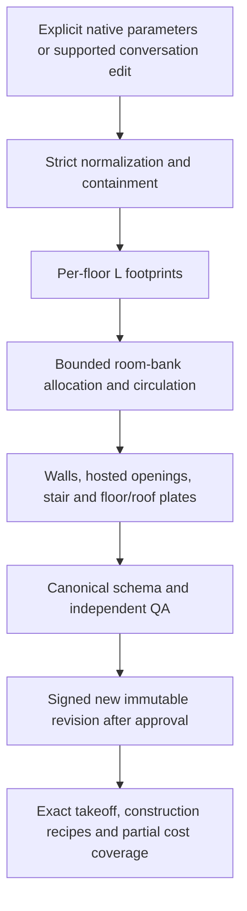

# Phase 22 — bounded parametric architecture

## Selection and compatibility

`parametricArchitecture` is an explicit native requirements opt-in selecting `parametric-architecture-v1`. `generateParametricBlueprint` is the library entry point. `generateBlueprintForVersion(input, PARAMETRIC_VERSION)` explicitly dispatches it. Omitting the version from that function still selects V1, and passing parametric requirements to a historical solver fails strict validation. `layoutV2` continues selecting `precision-blueprint-v2`; combining the two extensions is invalid.

The canonical document remains Building Model V2. Its existing simple floor boundaries, polygonal spaces, wall centerlines, hosted openings, slab outer/void rings and stairs faithfully represent the implemented L family. An optional `parametricArchitecture` submodel has version 1. It is absent from historical models, with no new defaults or implicit migration. Historical seed/hash/identity behavior is retained, including arbitrary version salts accepted by the requirements hash utility. Generator dispatch remains restricted to known versions.

No database migration is necessary. Native requirements and the canonical model are already JSON documents in signed immutable revisions. The accepted revision carries parameters, geometry, requirements hash, model hash, generator version, seed, generation ID, QA evidence and parent revision ID.

## Supported geometry and parameters

Rectangles remain supported by historical V1/V2 engines. The new mode supports axis-aligned L footprints, consisting of a west wing and a south extension, on validated simple orthogonal sites. One or two floors share an explicit origin. Every upper-floor point must lie inside the lower footprint. Width, depth, west-wing width and south-wing depth may differ by floor. Neither footprint is a bounding-box substitute.

Example requirements are reproducible through `test-support/parametric-fixtures.ts`:

```json
{
  "site": {
    "boundary": [{"x":0,"z":0},{"x":22000,"z":0},{"x":22000,"z":22000},{"x":0,"z":22000}],
    "northMilliDegrees": 0
  },
  "floors": 2,
  "rooms": [
    {"type":"living","count":1,"level":0},
    {"type":"kitchen","count":1,"level":0},
    {"type":"bedroom","count":2,"level":1}
  ],
  "parametricArchitecture": {
    "version":1, "shape":"L", "origin":{"x":1000,"z":1000},
    "floors":[
      {"level":0,"widthMm":18000,"depthMm":18000,"westWingWidthMm":9000,"southWingDepthMm":8000},
      {"level":1,"widthMm":16000,"depthMm":16000,"westWingWidthMm":8500,"southWingDepthMm":7000}
    ]
  },
  "seed":"phase22"
}
```

All four floor dimensions are integer millimetres from 1000 to 60000. West width must be strictly smaller than total width; south depth strictly smaller than total depth. These are initial parameter bounds, not a feasibility guarantee. Wall, door, stair and room minimums can require larger values. Exterior/interior wall thicknesses must be even, with interior no thicker than exterior. The clear corridor minimum is 600 mm; it is a product capability bound, not accessibility certification. North remains orientation metadata; rotating the footprint is unavailable.

The footprint area is `westWidth * depth + (width - westWidth) * southDepth`. The six-vertex boundary has positive winding. `describeParametricWings` reconstructs two disjoint typed regions with stable IDs, parent level/building references, reciprocal connections, parameter-rebuild transformation semantics and deterministic provenance. These architectural regions are not additional physical slabs. They are derived from persisted parameters, without a separate storage system.

U footprints, enclosed courtyards, arbitrary holes, balconies, accessible terraces, cantilevers, detached wings, freeform curves, columns and more than two floors are unavailable in this mode. Their unsupported settings fail strict normalization; unsupported shape families have the portable `UNSUPPORTED_PARAMETRIC_CAPABILITY` error. Nonrectangular sites with setbacks still need an explicit buildable polygon, following V2's existing restriction. Rectangular site edge setbacks are enforced against each requested footprint.

## Room placement and topology

The allocator reserves a horizontal frontage corridor and a vertical west-wing corridor as one connected L-shaped space. Occupied rooms remain rectangles. The west room bank partitions along z; the south-extension bank partitions along x. Both wings receive occupied rooms. A floor needs at least two requested rooms. Automatic assignment balances room counts deterministically; explicit room levels are recommended for constrained programs. Hard relationships can make this bounded family infeasible even when a more general planner could solve them.

For two floors, a common west stair strip is reserved beside the vertical corridor. A single straight flight has exactly reconciled integer riser heights, tread/run arithmetic, bottom and top landings, landing access doors and a matching upper-floor slab void. Different upper depths do not move the flight origin. The smaller upper floor must retain sufficient space for both landings.

Wall construction splits all coincident space edges into unique disjoint intervals. Single-sided intervals are exterior; two-sided intervals are interior. Independent QA additionally proves that exterior segments coincide with the actual concave inset footprint. Hosted doors connect rooms to circulation; hard direct/passage relationships require real openings. Clearances include perpendicular wall half-thickness and explicit jamb allowance. Concave facades get the same exterior-window treatment as other exterior boundaries; they are not enclosed courtyard walls.

Rooms reserve conservative clear dimensions using exterior thickness on all faces. This guarantees their minimums when interior thickness is no larger. QA separately reconstructs the actual wall-face clear rectangles. Reported clear areas are conservative, including an inset L circulation polygon; they are not certified net usable or statutory areas.

## Floor plates, voids and roofs

Each floor has its own exact nonrectangular slab. Ground slab area is 234 m² in the example. The upper gross area is 188.5 m², with a 4.2 m² flight void, giving total net floor plates of 418.3 m². The upper storey has a flat roof. A bounded orthogonal cell difference decomposes the ground footprint minus the upper footprint into disjoint lower roof plates, totalling 45.5 m². All roofs together cover 234 m² in plan.

An exposed lower roof is not an accessible terrace: there is no terrace access, guard, drainage, finish or structural certification implied. A stair core is not an occupied room. Parametric takeoff excludes stair cores from ordinary space/finish floor-area bases and reports their finish coverage as `NOT_EVALUATED`; explicit stair flight/landing schedules remain available. Floor slab void deductions use exact polygon arithmetic.

## Changes and propagation

`modifyParametricRequirements(input, {level, parameter, valueMm})` returns a normalized copy; it does not mutate accepted input or geometry. The allowed parameter enum is `widthMm`, `depthMm`, `westWingWidthMm`, `southWingDepthMm`. Existing native room constraints and corridor-width intent remain available.



This finite dependency order performs a full rebuild. It permits no user-authored expressions or dependency graph, so there is no recursive partial mutation or expression-cycle execution. Cyclic/non-plain input is rejected by bounded preflight. Invalid changes produce no accepted revision. Candidate rejection codes distinguish program, stair, relationship and resource failures; failures within the family do not prove general architectural impossibility.

## Conversation and AI boundary

Start a parametric project through explicit native generation, then create a conversation based on that revision. The conversation records solver `PARAMETRIC`. The existing exact proposal/version/base revision/hash/expiry approval contract is unchanged.

A user-only native message can contain:

```json
{"nativeUpdate":{"parametricEdit":{"level":0,"parameter":"westWingWidthMm","valueMm":10000}}}
```

Use the existing text `Use these values` for native-only updates. The tested local text grammar is deliberately narrow: `Set`, `Increase` or `Reduce`, optional `the`, `ground` or `upper`, `floor`, one of `west wing width`, `south wing depth`, `width`, `depth`, followed by `to <integer> mm`. Example: `Increase the ground floor west wing width to 10000 mm.` This means set the named value; it is not a relative delta.

No claim is made for arbitrary architectural language, courtyard changes, word-number units, relative movement or unspecified “make the upper floor smaller.” Unsupported language stays visible for clarification. Providers cannot return the user-only parametric edit, native model geometry, approval or QA evidence through their strict intent schema. Registry, routing, remote/local transport, privacy, retry and cost controls are retained. No media or engineering provider capability is activated.

## Independent QA and quantities

The verifier imports no generator or solver code. It rebuilds the expected six-vertex outer and inset boundaries, checks winding/orthogonality, and independently reconstructs wall adjacency. Nonoverlapping contained space polygons must sum exactly to the complete inset footprint, proving coverage without invisible gaps. Every space edge requires wall coverage. Physical wall prisms must stay on their own floor. Upper footprints must be supported by the lower footprint.

The verifier checks floor slabs, exact flight voids, occupied-space/void separation, disjoint exposed roofs, corridor arms/elbow clearance, opening jambs/frontage, all room minimums and hard relationships. It uses the existing independent door/passage/stair graph for entrance reachability. Duplicate IDs, malformed references, corrupt indices, missing slabs/doors, wrong winding, extra holes, changed parameters, moved flights and roof gaps are tested by mutating generated models. Scores and reported areas are never used as geometric evidence.

Quantity takeoff uses actual polygon area minus holes, wall centerline lengths/segment prisms, opening deductions, explicit stair geometry and per-floor schedules. Wall junction prisms remain non-unioned with the historical limitation. Construction recipes and rate tables do not change. Incomplete stair finishes and other existing unsupported material/engineering categories propagate through construction coverage and partial cost status. Parking-cost limitations are untouched. No new price is invented.

## Identity and resources

Room IDs use semantic type/ordinal; floors and stair/slab identities retain their roles. Wing IDs are `wing-<level>-west` and `wing-<level>-south`. Walls use level and endpoints; openings use host, offset and width. A changed physical interval gets a new identity; unchanged room roles keep theirs. Dimensions are regenerated derived/controlling measurements. Deterministic normalized input and seed reproduce canonical geometry and hashes. Timing diagnostics are outside the canonical model.

There are at most 24 rooms, two floors, 32 site vertices, six footprint vertices and eight corridor vertices. The scheduler tries at most four seeded room orders and bounded bank splits, subject to the existing maximum 128 candidates and 20000 charged search/construction work units. These units are deterministic accounting charges, not a count of every machine instruction or exact polygon predicate. QA independently has its own geometry-work budget. Parametric model checks cap 28 spaces, 200 walls and 32 slabs. Orthogonal roof difference uses only the coordinate cuts of two six-vertex footprints. Input preflight caps 5000 nodes, depth 12 and collection size 128 before normalization. An execution deadline defaults to ten seconds, and cancellation is checked between bounded phases. JSON/entity limits bound memory; no global cache accumulates candidates.

The benchmark records normalization, layout, construction, total generation, independent QA, full elapsed time, heap delta/RSS, charged work and candidate count. Heap deltas may be negative due to GC. Three repetitions establish deterministic outcomes for the measured fixtures, not production SLOs. The V2 comparison is a rectangular reference workload; speed differences do not establish equal search quality or a general performance gain.

## Future interoperability

The resulting model is a bounded foundation for future BIM adapters: explicit levels, typed geometric entities, stable identity, voids and immutable provenance are available. It is not IFC/BIM certification, structural engineering, MEP, fire/accessibility approval, seismic/wind analysis, a CAD replacement or professional construction documentation. Phase 23 has not been started.
